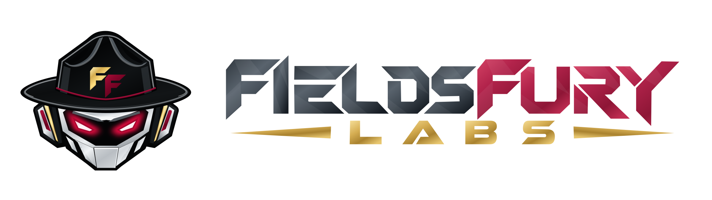
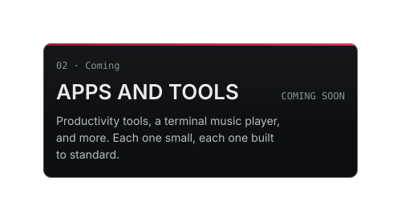

  <picture>
    <source media="(prefers-color-scheme: dark)" srcset="assets/fieldsfury-lockup-horizontal-dark-v003-2400x676.png">
    
  </picture>

  <b>A veteran-owned, independent software lab focused on open source.</b> 
  We build a Linux distribution, apps and tools: everyday software that's polished, simple and dependable.

  <code>simple is hard</code>&nbsp;·&nbsp;<code>we do the hard part</code>&nbsp;·&nbsp;<code>the fury stays in the lab</code>

<h3 align="center">On the bench</h3>

  
  

<b><code>&gt; cat fury.txt</code></b> &nbsp;what "fury" means here

 

All the intensity goes into the making, so none of it reaches you.

**Fury in the making. Calm from day one.**

<b><code>&gt; ./contact</code></b>

 

| Channel | Address |
| :-- | :-- |
| Site | [fieldsfurylabs.com](https://fieldsfurylabs.com) |
| Mail | `hello@fieldsfurylabs.com` |
| Security reports | `security@fieldsfurylabs.com` |

The first repositories open as each project passes inspection. Follow the org to see them land.

  © 2026 FieldsFury Labs · Veteran-owned The Instructor Brim robot design™, Bibim™ and the Bibim B logo™ are trademarks of FieldsFury Labs; FieldsFury™ and FieldsFury Labs™ are also trademarks.

